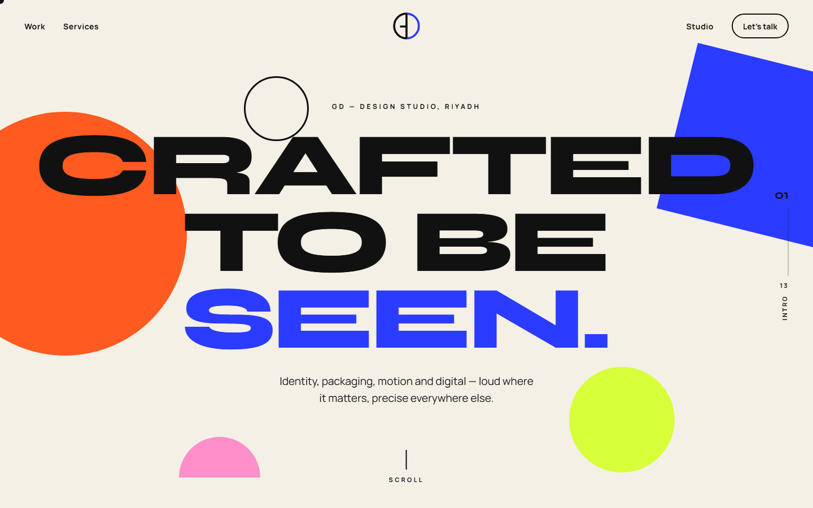
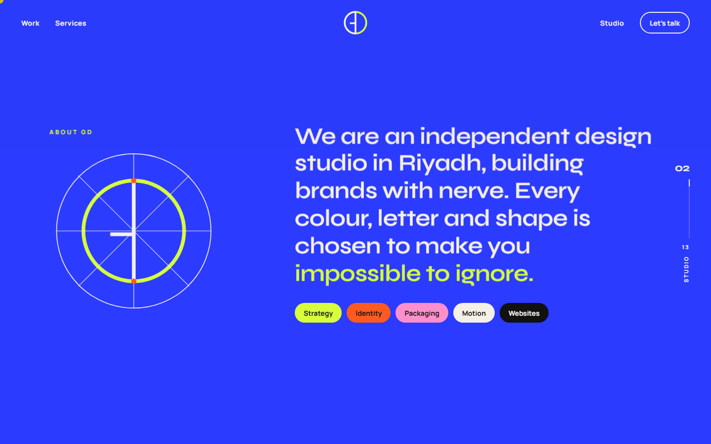
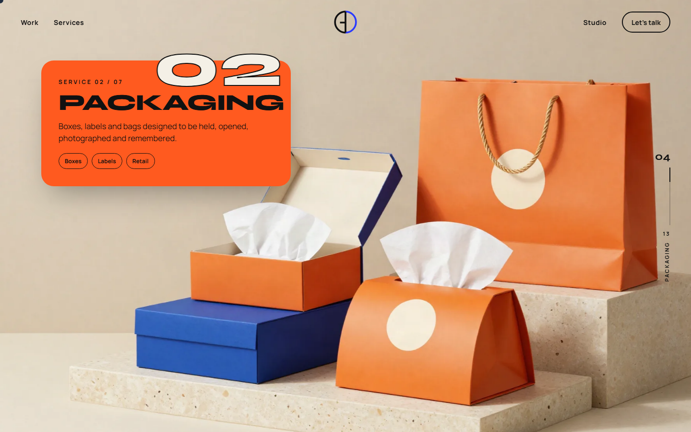
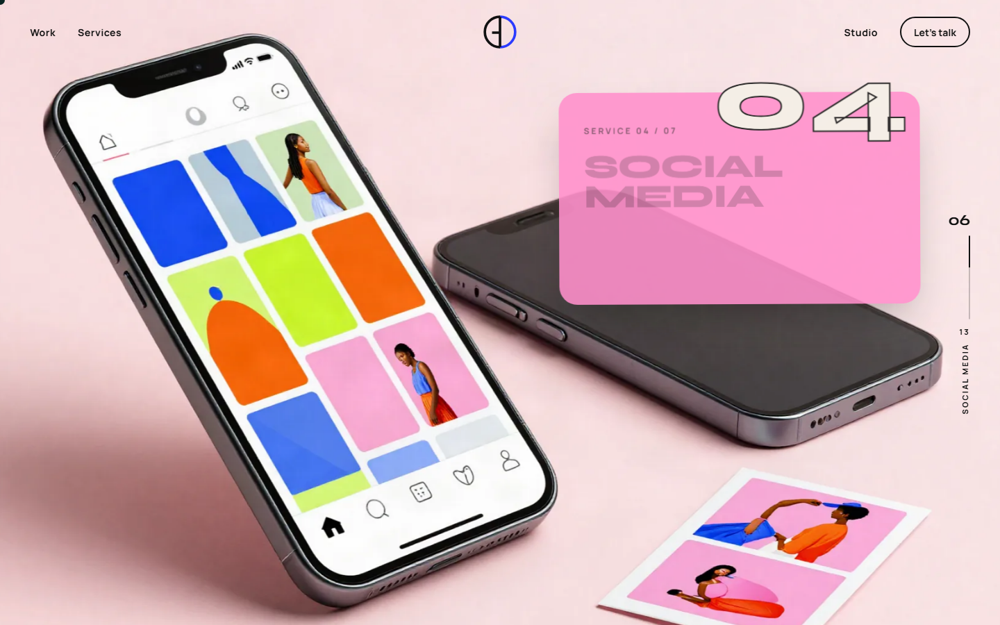
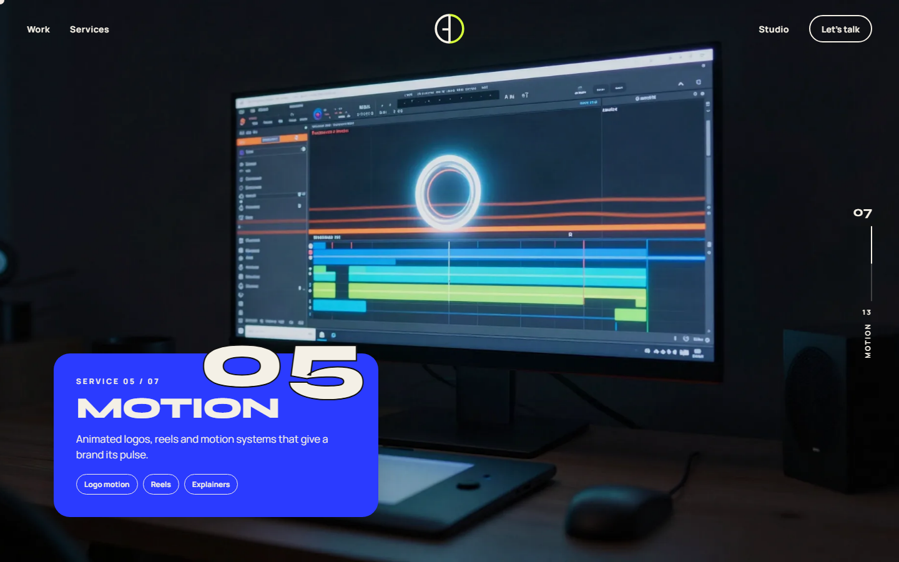
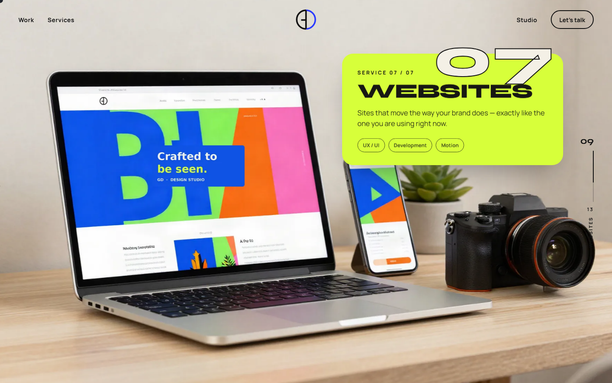
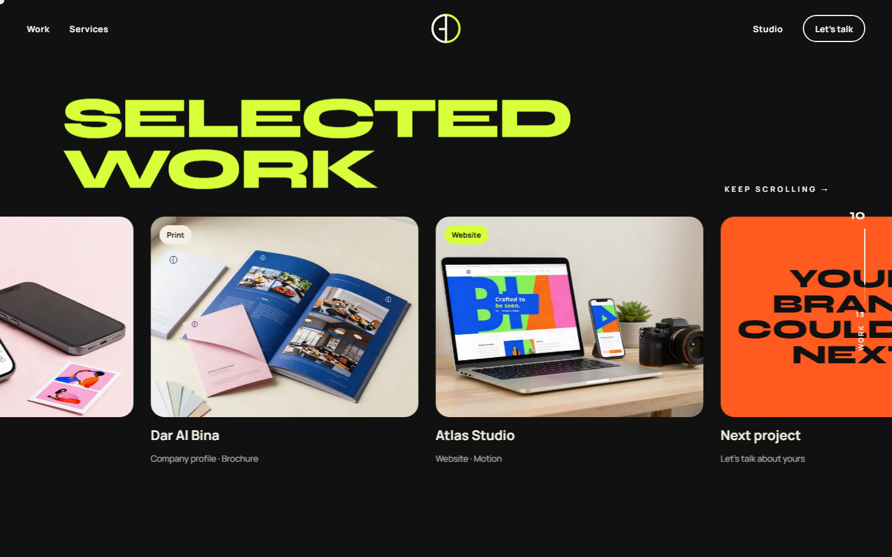
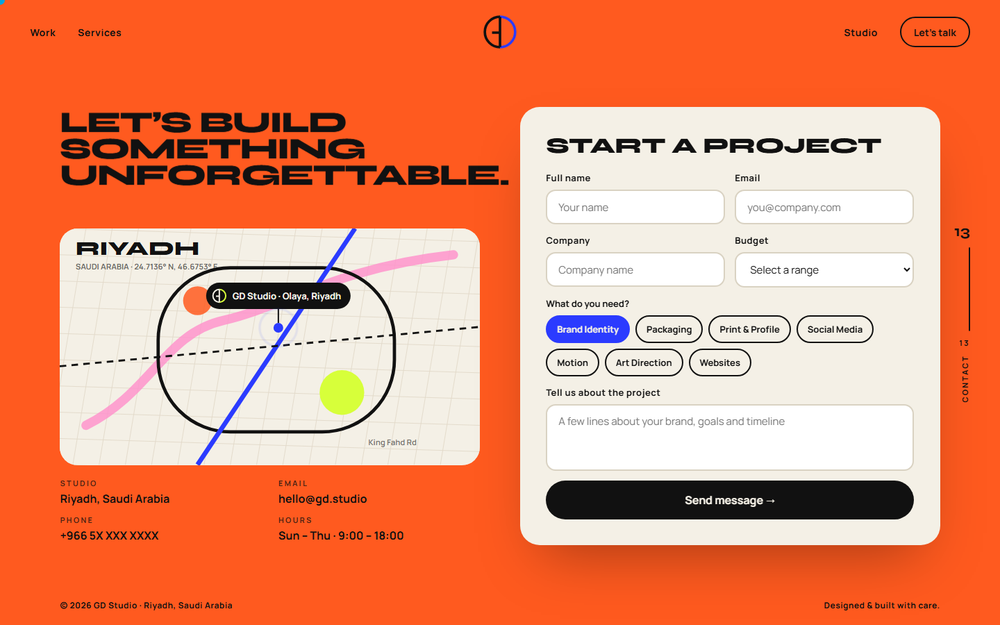
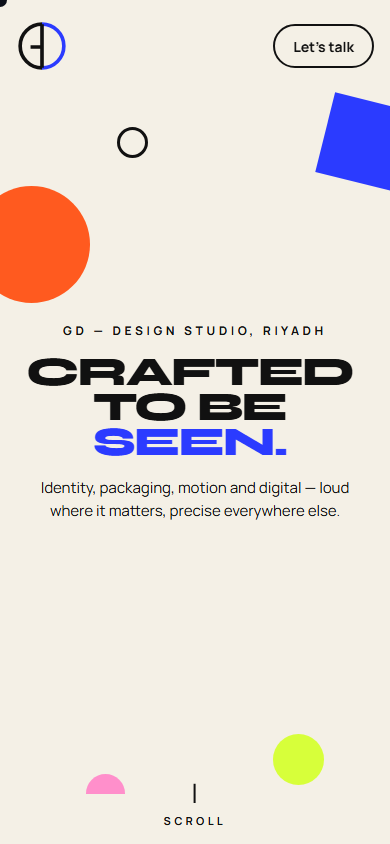

# GD — Graphic Design Company

**Crafted to be seen.** A one-page, scroll-driven website for GD, a graphic design studio based in Riyadh, Saudi Arabia.

Identity, packaging, print, social media, motion, art direction and websites. Each service has its own scene, and every scene opens with its own transition.

🔗 **Live site:** https://gd-graphic-design-company.vercel.app



---

## Screenshots

| | |
|---|---|
|  |  |
| **About:** the studio in one sentence | **Packaging:** boxes, labels, retail |
|  |  |
| **Social media:** the feed builds tile by tile | **Motion:** logo motion, reels, explainers |
|  |  |
| **Websites:** zooms out of a browser | **Selected work:** horizontal gallery |



<p align="center"></p>

---

## Tech stack

- **[Next.js 15](https://nextjs.org/)** (App Router, static export)
- **React 19** + **TypeScript**
- **[GSAP](https://gsap.com/)** for the scroll timeline and scene transitions
- **[Lenis](https://lenis.darkroom.engineering/)** for smooth scrolling
- **Syne** and **Manrope** fonts (self-hosted via Fontsource)
- Hosted on **[Vercel](https://vercel.com/)**

## Run it locally

```bash
npm install
npm run dev        # http://localhost:3000
npm run build      # static export into ./out (upload ./out to any host)
npm start          # serve the built ./out folder
```

## Project structure

```
app/
  layout.tsx       page shell, fonts, metadata
  page.tsx         renders the experience
  globals.css      colours (top of file), layout and phone styles
components/
  Experience.tsx   every scene, the scroll timeline and all transitions
public/img/        the seven service photos (full size + -sm for phones)
docs/screenshots/  images used in this README
```

## Scenes and transitions

Preloader (monogram drawn on a construction grid) → Hero → About (cobalt circle grows) →
Brand Identity (page folds in thirds) → Packaging (box flaps open) → Print (page turns) →
Social (feed builds tile by tile) → Motion (film strip slides in) → Art Direction (camera iris opens) →
Websites (zooms out of a browser) → Work (horizontal gallery) → Process (page folds up) →
Try your brand (diagonal wipe) → Contact (envelope opens).

## Notes

- The contact form shows a thank-you message but doesn't send anything yet. To make it send, connect EmailJS (or any form service) in the form's `onSubmit`.
- Deployed on Vercel as the project `gd-graphic-design-company`. To redeploy by hand: `vercel deploy --prod`.

---

© 2026 GD Studio · Riyadh, Saudi Arabia
